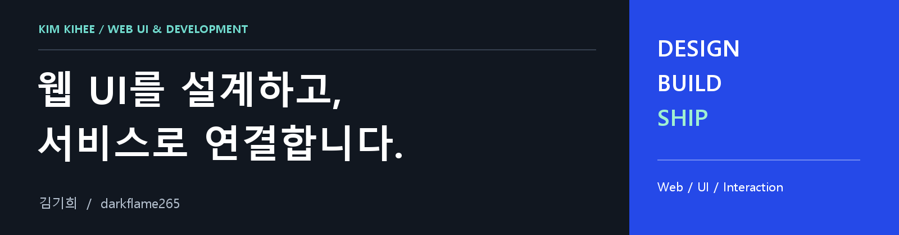
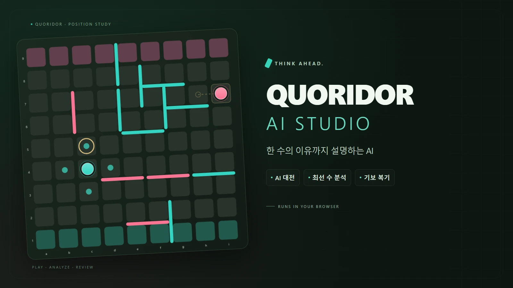
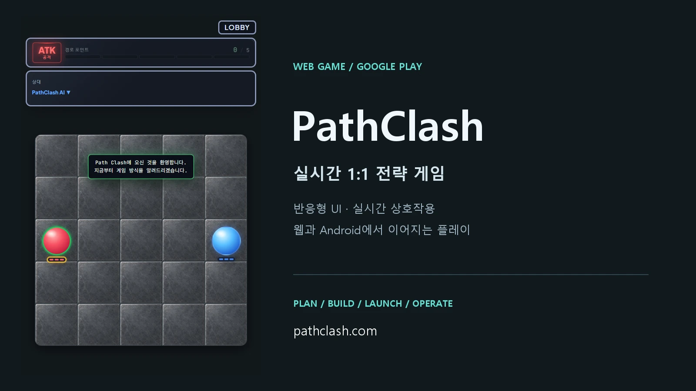
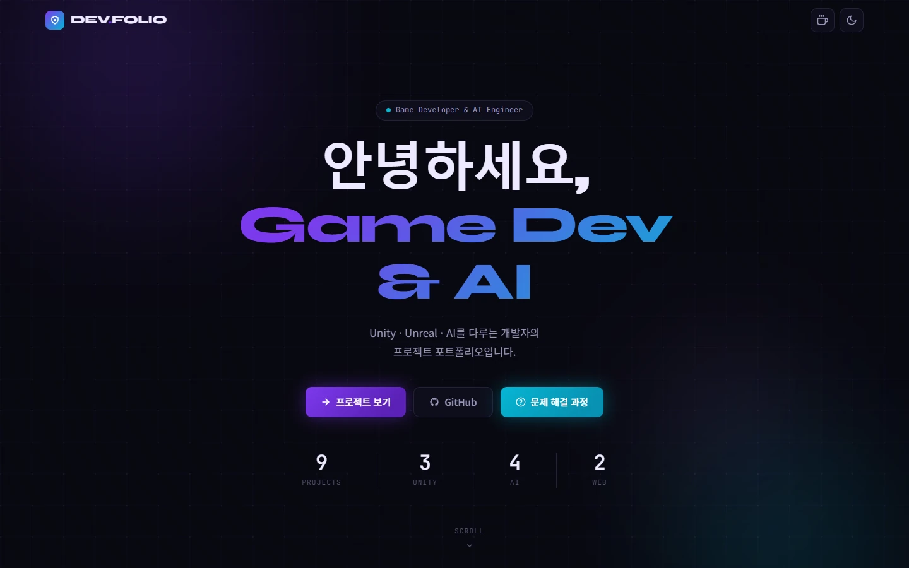

# 김기희

**웹 UI 설계 · 구현 · 서비스 출시**

웹게임과 AI 도구의 인터페이스를 만들고, 브라우저와 모바일에서 사용할 수 있도록 개발·출시하고 있습니다.

  

[Web 프로젝트](#web-projects) · [기술 스택](#tech-stack) · [추가 경험](#more-projects)

## Web Projects

화면의 구성과 상호작용부터, 실제 사용할 수 있는 서비스까지 직접 연결한 프로젝트입니다.

### 01 / Quoridor AI Studio

**한 수의 이유까지 이해할 수 있는 쿼리도 웹 앱**

AI 대전·관전, 기보 복기, 최선 수 추천을 하나의 화면 흐름으로 구성했습니다. 한국어·영어 전환과 화면 공유 기반 보드 인식·동기화를 지원합니다.

- **UI / UX:** 보드·분석·기보 탐색 UI와 추천 이유 설명을 구현했습니다.
- **브라우저 실행:** 방문자 PC에서 ONNX/WASM 추론과 PUCT 탐색을 실행해 별도 AI 서버 설치 없이 사용할 수 있습니다.
- **기여 범위:** 외부 SigmaQuoridor 모델·기반 코드를 활용해 UI, 화면 인식·동기화, 브라우저 AI 실행과 기보 기능을 구현·통합했습니다. 신경망을 처음부터 학습한 프로젝트는 아닙니다.

`JavaScript` `HTML` `CSS` `ONNX Runtime Web` `WASM` `Vite`

---

### 02 / PathClash

**직접 기획하고 출시·운영하는 실시간 1:1 전략 게임**

5×5 보드에서 경로를 그려 추격자와 도망자 역할을 번갈아 수행하는 웹게임입니다. 웹 UI부터 클라이언트·서버 개발, Google Play 출시와 운영까지 담당했습니다.

- **반응형 UI:** 모바일·태블릿·데스크톱에서 플레이할 수 있도록 레이아웃을 개선했습니다.
- **실시간 상호작용:** Socket.IO 기반 대전과 재접속 시 게임 상태 복구를 구현했습니다.
- **출시 / 운영:** Capacitor로 Android 앱을 패키징해 Google Play에 출시하고 기능·사용성을 개선하고 있습니다.

`React` `TypeScript` `Node.js` `Socket.IO` `Supabase` `Capacitor`

---

### 03 / DEV.FOLIO

**프로젝트를 탐색하고 결과물을 확인하는 개인 포트폴리오**

HTML·CSS·JavaScript로 직접 구현하고 GitHub Pages에 배포했습니다. 카테고리 필터와 최신순 정렬로 프로젝트를 탐색하고, 사이트·소스·영상으로 연결할 수 있습니다.

- **화면 구성:** 반응형 카드 그리드와 다크·라이트 테마를 구현했습니다.
- **인터랙션:** 스크롤 진입 애니메이션과 타이핑 효과를 적용했습니다.
- **가시성:** 링크 목적별 색상·아이콘과 터치하기 편한 버튼 크기로 결과물 접근성을 개선했습니다.

`HTML` `CSS` `JavaScript` `GitHub Pages`

---

## Tech Stack

**Web / UI**

**Service / Delivery**

**AI Development Tools**

## More Projects

<strong>게임 · 강화학습 · 3D 개발 경험 보기</strong>

| 프로젝트 | 구현 경험 |
| --- | --- |
| [흑길동 : 대유쾌 마운틴](https://github.com/darkflame265/PlayGround_good) | Unity·C# 기반 클라이밍 게임, 캐릭터 제어와 피드백 기반 플레이 개선 |
| [동방 자동 플레이 AI](https://github.com/darkflame265/01_touhou_ai_project) | Python·PyTorch·OpenCV, CSRT 트래킹과 PPO 기반 자동 플레이 |
| [회피 게임 AI](https://github.com/darkflame265/05_avoid_game_ai) | Python·PyTorch, 벡터 기반 MLP와 PPO 강화학습 |
| [학교 강의실 모델링](https://github.com/darkflame265/blenderCNSU) | Blender로 실제 강의실을 모델링하고 Unreal Engine으로 재현 |

**Additional Tools:** Unity · C# · Unreal Engine · Blender · Python · PyTorch · OpenCV

---

**화면과 동작을 직접 확인해 주세요.**

[포트폴리오](https://darkflame265.github.io/07_portfolio_site/) · [개발 기록](https://velog.io/@darkflame265/posts) · [ter2490@naver.com](mailto:ter2490@naver.com)
